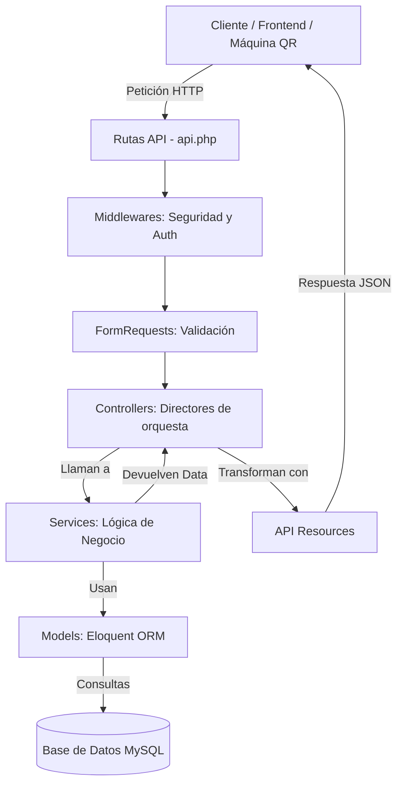
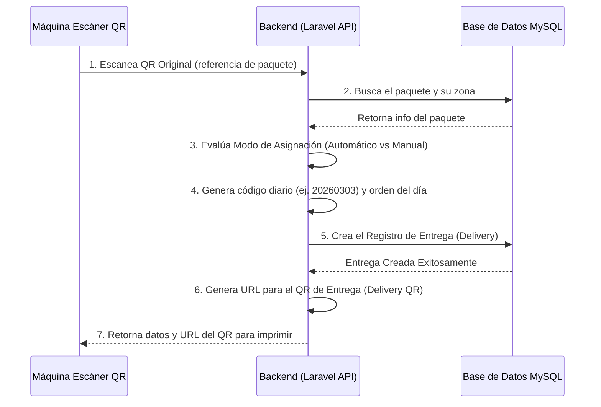

# Arquitectura del Sistema

Este proyecto sigue un patrón de **Arquitectura por Capas** (Layered Architecture) adaptado para una aplicación API-first en Laravel. Este enfoque garantiza una estricta separación de responsabilidades, haciendo que el sistema sea seguro, escalable y mantenible.

## Diagrama de la Arquitectura por Capas

A continuación se dibuja cómo fluye una petición desde que el cliente la hace hasta que recibe respuesta, y qué hace cada capa:

## ¿Qué hace cada capa exactamente?

1. **Rutas (Routes & api.php)**
   * **¿Qué hace?** Es la puerta de entrada. Mapea la URL (ej. `/api/v1/deliveries`) hacia el Controlador adecuado.

2. **Middlewares**
   * **¿Qué hace?** Son los "guardias de seguridad". Verifican que la petición tenga un token JWT válido, revisan roles y permisos antes de dejar pasar la petición al resto del sistema.

3. **FormRequests**
   * **¿Qué hace?** Es la capa de validación pura. Se encarga de revisar que los datos enviados por el usuario sean correctos (ej. que el email tenga formato de email, que el ID exista en la base de datos). Evita que el Controlador se llene de validaciones manuales.

4. **Controllers (Controladores)**
   * **¿Qué hace?** Son los directores de orquesta. Deben ser "delgados" (poco código). Reciben la petición ya validada, se la pasan al Servicio (Service) para que haga el trabajo pesado, y luego toman la respuesta del Servicio y la devuelven al cliente. **Nunca** deben tener reglas de negocio complejas ni consultas SQL directas.

5. **Services (Servicios)**
   * **¿Qué hace?** Son el "cerebro" del sistema. Aquí va toda la **lógica de negocio**. Si hay que asignar un paquete a un conductor, calcular rutas o crear un código diario, eso se hace aquí. Los Controladores llaman a los Servicios.

6. **Models (Modelos Eloquent ORM)**
   * **¿Qué hace?** Representan las tablas de la base de datos (ej. tabla `deliveries` -> modelo `Delivery`). Definen las relaciones (un paquete pertenece a un conductor) y facilitan toda la comunicación con la base de datos.

7. **API Resources (Recursos API)**
   * **¿Qué hace?** Son los "maquilladores" de datos. Toman la información bruta de la base de datos (Modelos) y la transforman en un JSON limpio y estructurado que el frontend o la máquina QR entienda, ocultando campos sensibles (como contraseñas o timestamps irrelevantes).

## Flujo del Sistema (Máquina de Entrega QR)

Dado el contexto del proyecto (Máquina de lectura de QR), el flujo de negocio principal se dibuja así:

